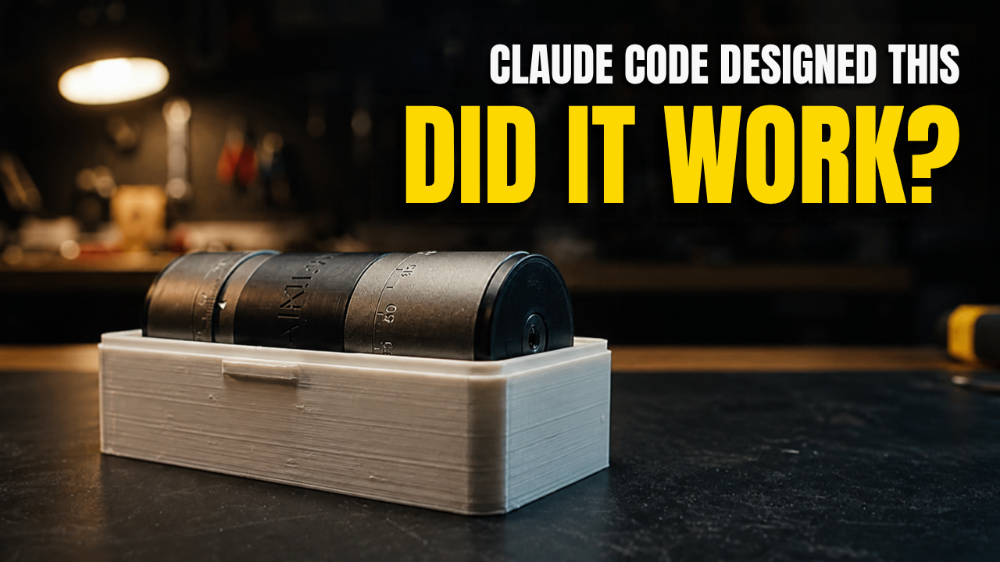

# Kingrinder K6 Case

[](https://youtu.be/1Gm2xxaxk2Y)

**Watch the video: https://youtu.be/1Gm2xxaxk2Y**

This repo is the companion to that video.

OpenSCAD models for a Kingrinder K6 hand grinder and a printable case built around it. Python build scripts render the `.scad` files to STL.

## Requirements

- [uv](https://docs.astral.sh/uv/)
- [OpenSCAD](https://openscad.org/) on your `PATH` (`openscad` command)

Each build script declares its own dependencies in an inline script header, so `uv run` handles the Python environment. No install step needed.

## Build

Run from the repo root.

### Grinder model

```sh
uv run src/kingrinder_k6/build.py
```

Writes `src/kingrinder_k6/output/kingrinder_k6.stl`.

### Case

```sh
uv run src/kingrinder_k6_case/build.py
```

Writes both case halves to `src/kingrinder_k6_case/output/`:

- `lower_case_body.stl` (bottom half)
- `upper_case_body.stl` (top half)

The STLs are not published in this repo. Generate them yourself with the build scripts above.

The case includes a frozen copy of the grinder model, `src/kingrinder_k6_case/old_grinder/kingrinder_k6_old.scad`, so edits to `src/kingrinder_k6/kingrinder_k6.scad` do not change the case.

### Seam test plate

```sh
uv run src/kingrinder_k6_case/seam_test_build.py
```

Writes `src/kingrinder_k6_case/output/seam_test/seam_plate.stl`. `seam_test.scad` is self-contained and does not include the case file.
